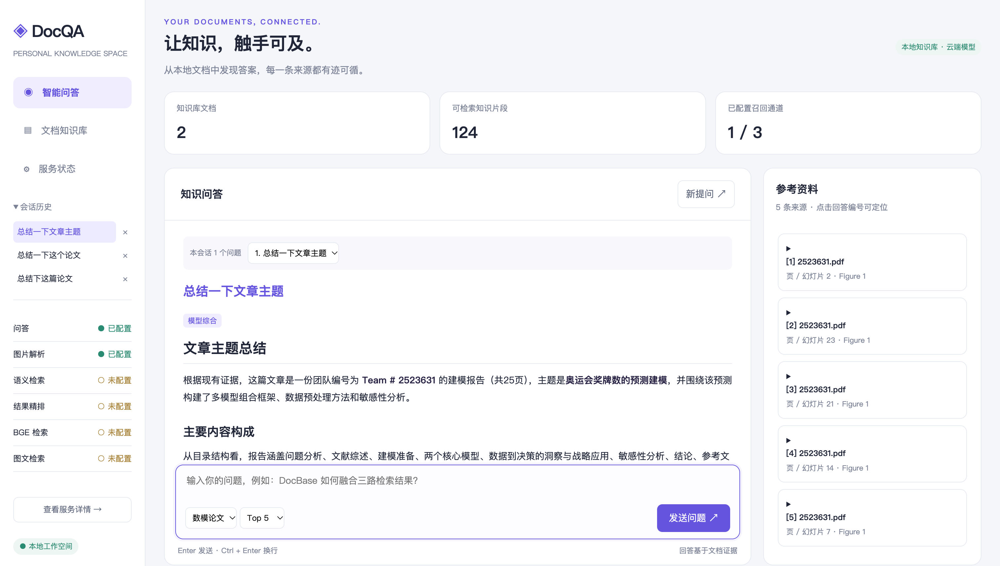
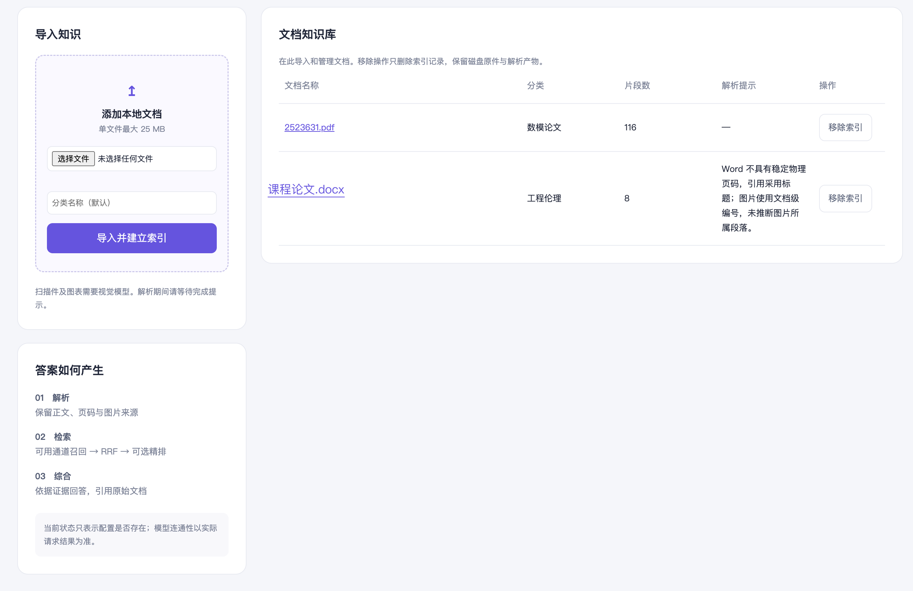
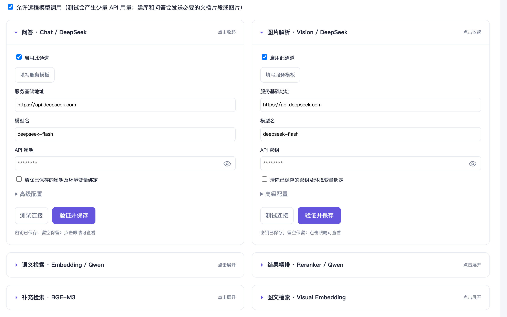
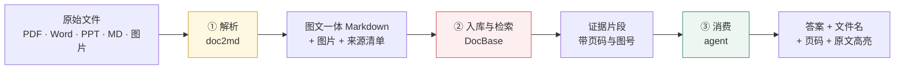

<div align="center">

# DocQA

**让沉睡的文档开口说话**

把 PDF、Word、PPT、Markdown 和图片整理成个人知识库，
用自然语言提问，每个答案都能回到原文那一页、那一行。

[](https://www.python.org/)
[](LICENSE)
[](#%E9%9A%90%E7%A7%81%E4%B8%8E%E6%95%B0%E6%8D%AE)
[](#%E5%BF%AB%E9%80%9F%E5%BC%80%E5%A7%8B)

</div>



---

## 这是什么

一个**跑在自己电脑上**的文档问答工作台。索引、原文、会话全部留在本地，模型可以全本地、全云端，也可以混着配。

和常见的在线文档助手相比，它多做两件事：

- **能看懂图**。PDF 不抽文字，而是整页渲染成图交给视觉模型，图表、公式、流程图不会在解析时丢掉；图片同时建一条视觉向量通道，用文字也能搜到图。
- **能落回原文**。答案里的每个 `[1]` 都能点，跳到 PDF 对应那一页，并把匹配到的原文行高亮出来。匹配不到就只说"已定位到第 12 页"，不伪造高亮。

> 定位：面向**个人**的本地工具。服务只绑定 `127.0.0.1`，不含多用户账户与权限隔离，不适合直接部署到公网。

---

## 特性

| 能力 | 说明 |
| --- | --- |
| **5 类格式** | PDF / Word / PPT / Markdown / 图片，解析后统一成图文一体的 Markdown |
| **保留出处** | 每个片段带 `source=X.pdf · page=12 · Figure 1`，页码来自文档本身而非重新编号 |
| **4 路召回** | BM25 关键词、文本语义向量、BGE-M3 补充稠密、图文向量，加权 RRF 融合后可选精排 |
| **引用校验** | 回答里的引用编号必须是本次检索结果的子集，越界则整段不展示 |
| **页内高亮** | 点击引用预览 PDF 原文页，逐行精确匹配并高亮；图表只定位到页 |
| **可恢复入库** | 导入跑在独立子进程，任务状态落盘，网页不阻塞；失败保留原件与旧索引，可一键重试 |
| **模型热切换** | 6 个模型角色独立配置，换模型时按指纹决定「只刷向量」还是「临时重建」，成功才切换 |
| **可评测** | 支持人工标注的检索评测，对比 BM25 / 混合 / 混合+精排三种策略 |

<table>
<tr>
<td width="50%"></td>
<td width="50%"></td>
</tr>
<tr>
<td align="center">文档知识库：导入、分类、片段数、解析提示</td>
<td align="center">服务状态：6 个模型角色独立配置</td>
</tr>
</table>

---

## 架构

三层解耦，一条数据流。**所有模型调用都收在「模型协议边界」内**——线里是模型，可以换；线外是本地数据格式，不动。



| 层 | 模块 | 输入 → 输出 | 关键点 |
| --- | --- | --- | --- |
| 解析 | [`docqa/doc2md.py`](docqa/doc2md.py) | 原始文件 → Markdown + 图片 + 来源清单 | 120 dpi 整页渲染 + 视觉模型，图注写回原位 |
| 入库与检索 | [`docqa/docbase.py`](docqa/docbase.py) | Markdown → 切片 → 索引 → 证据片段 | 切片 1000/150，自研中文切词，加权 RRF |
| 消费 | [`docqa/agent.py`](docqa/agent.py) | 证据 → 带引用的回答 | 证据不足显式声明，引用编号强校验 |

数据落地：`SQLite` + 本地文件，默认在 `data/` 下。

---

## 快速开始

需要 **Python 3.11+**。首次安装依赖需要联网，页面资源（Markdown、Mermaid）随程序提供，不依赖 CDN。

### macOS / Linux

```bash
git clone https://github.com/SSSherl/DocQA.git
cd DocQA

python3 -m venv .venv
.venv/bin/python -m pip install -e .
cp config.example.json config.json
.venv/bin/python -m docqa serve
```

### Windows

```powershell
git clone https://github.com/SSSherl/DocQA.git
cd DocQA
.\start.ps1
```

`start.ps1` 会自动创建虚拟环境、安装依赖，并在缺少 `config.json` 时从模板复制。

打开 <http://127.0.0.1:8765>，在「文档知识库」导入资料，在「智能问答」提问。

> **不配置任何模型也能用**：可以导入文字资料、走 BM25 检索、看到真实原文摘录，只是没有模型综合和图片理解。

---

## 配置模型

六个角色互相独立，可以只启用需要的，也可以指向不同厂商。**密钥不写进配置文件**，只通过环境变量或系统加密凭证读取。

| 角色 | 能力 | 密钥环境变量 | 不启用时的影响 |
| --- | --- | --- | --- |
| `chat` | 回答综合、流式输出 | `DOCQA_CHAT_KEY` | 退化为原文摘录 |
| `vision` | 图片内容解读 | `DOCQA_VISION_KEY` | 图片只有占位，无法读图 |
| `embedding` | 文本语义检索 | `DOCQA_EMBEDDING_KEY` | 只剩 BM25 关键词召回 |
| `reranker` | 候选资料精排 | `DOCQA_RERANKER_KEY` | 直接取 RRF 融合结果 |
| `bge` | 补充稠密向量 | `DOCQA_BGE_KEY` | 少一路召回 |
| `visual_embedding` | 文字查询图片 | `DOCQA_VISUAL_EMBEDDING_KEY` | 图片只能靠文字描述被搜到 |

推荐直接打开页面里的**「服务状态」**：填地址、模型名、密钥，点「测试连接」→「验证并保存」，无需重启。密钥框默认掩码显示，留空表示保留原值。

也可以手动配置（密钥仍走环境变量）：

```json
{
  "allow_remote_models": true,
  "chat": {
    "enabled": true,
    "base_url": "https://YOUR_PROVIDER/v1",
    "model": "YOUR_CHAT_MODEL",
    "api_key_env": "DOCQA_CHAT_KEY",
    "timeout": 120
  }
}
```

```bash
export DOCQA_CHAT_KEY="..."          # Windows: $env:DOCQA_CHAT_KEY = "..."
python -m docqa doctor --role chat   # 只发最小测试内容，不发文档
python -m docqa serve
```

**接口兼容性**：Chat / Vision 走 `/chat/completions`（流式需支持 SSE）；向量走 `/embeddings`；精排走 `/rerank`；图文模型需支持 `[{"text":"..."}]` 与 `[{"image":"Base64..."}]` 两种输入。**不要只按模型名判断兼容**。

远程调用默认关闭。开启后，相关证据片段或图片会发送到你配置的服务，费用与数据策略以服务商规则为准。

---

## 它是怎么工作的

### 1. 解析：图不能丢

PDF 不直接抽文字，而是按 **120 dpi** 把每页渲染成图片交给视觉模型，得到图注后写回原位置：

```markdown

source=paper.pdf · page=12 · Figure 1
<视觉模型对该图的描述>
```

这样图表、公式、流程图在检索阶段依然是"有内容"的，而不是一段空白。

### 2. 切词：中文的坑

通用分词器对专业术语经常切错，而且多一个依赖就多一个部署障碍。所以这里只用 7 行代码，**零分词器依赖**——中文按「单字 + 二字组」切：

```python
def tokens(text):
    text = text.lower()
    words = re.findall(r"[a-z0-9_]+", text)
    for run in re.findall(r"[\u4e00-\u9fff]+", text):
        words.extend(run)                                    # 单字
        words.extend(run[i:i+2] for i in range(len(run)-1))   # 二字组
    return words
```

「分组转发」→ `分 组 转 发 分组 组转 转发`，七个词元覆盖了它所有可能的问法。

切片按 **1000 字 / 重叠 150 字**，重叠是为了不让一句话被从中间切断。

### 3. 检索：加权融合，不是平均

四路召回同时跑，用加权 RRF 融合：

```
score(d) = Σ_routes  weight / (60 + rank)
```

BM25 默认权重 **2.0**，其余 1.0——实测在专业文档上，关键词精确匹配比语义更可靠。融合后可选 Reranker 精排，取 Top-5。

### 4. 问答：宁可不说，也不说错

```text
提问 → 检索 → 证据够吗？
              ├─ 够   → 综合 → 引用校验 → 通过 / 拦下
              └─ 不够 → 抽问题里的英文术语再查一轮（最多 2 轮）→ 回到检索
```

引用校验的判定很直接：取出答案里所有 `[n]`，必须是本次来源编号的子集，**否则整段不展示**，改为提示查看原文摘录。

回答状态一共有五种，页面会如实标注：`model`（模型综合）、`extractive`（原文摘录）、`no_evidence`（无证据）、`citation_rejected`（引用未通过）、`interrupted`（生成中断，不作为后续依据）。

---

## 常用命令

```bash
python -m docqa serve                      # 启动本地服务
python -m docqa build examples --category 示例   # 导入示例文档
python -m docqa query "混合检索如何工作？"        # 只检索，不调模型
python -m docqa ask "混合检索如何工作？"          # 检索 + 回答
python -m docqa list                       # 查看已导入文档
python -m docqa rebuild                    # 重建索引（保留分类）
python -m docqa refresh-images             # 只重建图片向量
python -m docqa compare examples/evaluation/cases.json --out result.json
python -m docqa doctor                     # 验证模型连通性
```

---

## 项目结构

```
DocQA/
├── docqa/
│   ├── doc2md.py          # 解析：PDF/Word/PPT/MD/图片 → Markdown
│   ├── docbase.py         # 切片、切词、BM25、多路召回、RRF 融合、精排
│   ├── agent.py           # 问答编排、证据判定、引用校验
│   ├── ingestion.py       # 入库流水线与缓存
│   ├── import_jobs.py     # 独立进程导入任务与状态落盘
│   ├── model_settings.py  # 模型配置、指纹、原子切换
│   ├── visual_index.py    # 图文向量索引
│   ├── pdf_view.py        # 引用定位与页内高亮
│   ├── server.py          # HTTP 接口
│   ├── streaming.py       # SSE 流式输出与中断
│   ├── knowledge_contract.md  # 回答约束（运行时注入系统提示）
│   └── web/index.html     # 单页前端
├── tests/                 # 112 项自动化测试
├── scripts/               # 发布校验、界面交互验证、基准测试
├── examples/              # 合成示例文档与评测集
├── docs/                  # 部署手册、需求规格、验收清单、截图
├── config.example.json    # 配置模板（不含密钥）
└── start.ps1              # Windows 一键启动
```

---

## 测试

```bash
python -m pip install -e ".[test]"
python -m pytest -q
```

112 项测试覆盖解析、切片、BM25、融合排序、引用校验、导入恢复、HTTP 边界与界面状态。`scripts/verify_*_ui.py` 是浏览器交互验证，需要安装 Chrome，部分脚本使用本地替换的模型响应，**不代表云端模型的实际效果**。

---

## 隐私与数据

- 服务只监听 `127.0.0.1`，不对外暴露。
- 索引、解析产物、会话记录默认在 `data/`，不进入版本库。
- 远程模型默认关闭；开启后仅发送检索到的证据片段或待解析图片。
- 密钥不落配置文件：Windows 使用当前用户 DPAPI 加密存在项目之外，其他系统读取环境变量。
- 项目**不会**自动加载 `.env`，也不会自动下载模型。

`.gitignore` 已排除 `config.json`、`data/`、凭证、缓存与虚拟环境。**提交前请确认没有把个人文档或密钥带进仓库。**

---

## 已知边界

诚实地说清楚做不到什么：

- **单机个人使用**。没有多用户、账户、权限隔离，不能直接当团队服务。
- **引用校验 ≠ 事实正确**。它只能保证引用编号不越界，不能保证模型理解正确，关键结论仍需人工核对。
- **Word / PPT 定位会降级**。没有稳定的物理页码，引用退到标题级；图片只给文档级编号，定位不到具体段落。
- **图表只定位到页**。图片解读的引用会翻到原图所在页，不伪造文字高亮。
- **PPT 原生组合图形**建议先导出 PDF 再导入。
- **扫描件依赖视觉模型**。未配置 vision 时，扫描版 PDF 基本不可用。
- **评测结果不通用**。仓库里的示例评测只验证流程，不证明在真实文档上的准确率。

---

## Roadmap

- [x] **个人级** —— 解析、检索、问答、Web、评测全部落地
- [ ] **团队级** —— 目录监控已具备，缺共享索引与权限
- [ ] **领域级** —— 知识图谱、跨文档推理

---

## 文档

| 文档 | 内容 |
| --- | --- |
| [部署手册](docs/部署手册.md) | 完整安装、模型配置、网络与批处理参数 |
| [需求规格说明书](docs/需求规格说明书.md) | 功能范围与验收标准 |
| [验收测试清单](docs/验收测试清单.md) | 逐项验收步骤 |
| [项目技术说明与创新点分析](项目技术说明与创新点分析.md) | 设计取舍与四点创新 |
| [发布说明](docs/发布说明.md) | 版本内容与不含项 |

---

## 贡献

欢迎 Issue 和 PR。提交前请先看 [CONTRIBUTING.md](CONTRIBUTING.md)——最重要的是：**不要提交个人文档、`config.json`、`data/` 或任何密钥**。

---

## License

[MIT](LICENSE)

## 致谢

课程《基于 AI Agent 的个人本地多模态文档智能问答系统》提供了原始方案骨架；本项目在其基础上完成了工程实现与四点改进。感谢东南大学。
