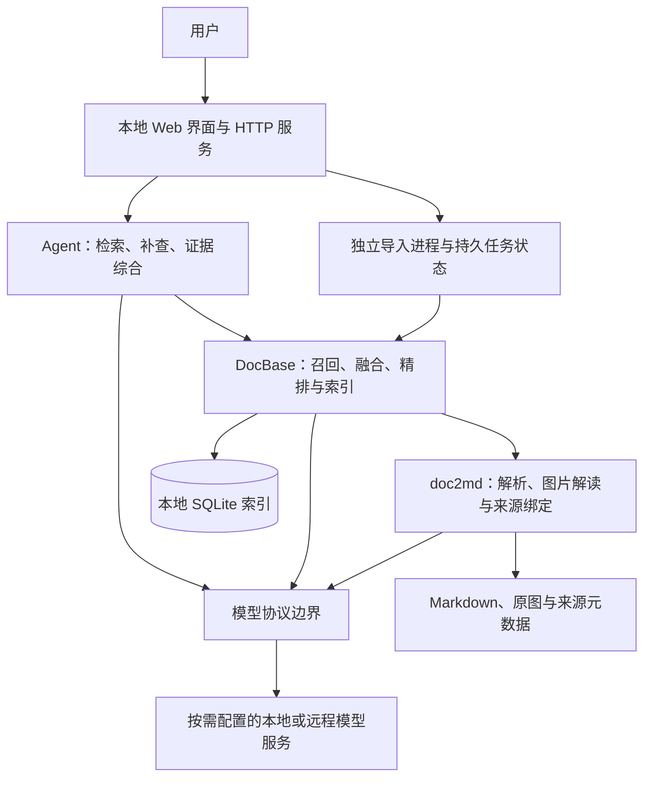

# DocQA 技术说明与创新点分析

> 项目名称：基于 AI Agent 的个人本地多模态文档智能问答系统  
> 文档日期：2026-10-26  
> 对照基线：用户提供的十二张原始方案图片  
> 实现基线：当前项目源码与 20261026-121011 发布版验收记录  
> 文档用途：技术交流、项目介绍、答辩及后续技术报告编写

本文区分三类内容：原图片已经提出的方案亮点、当前版本相对图片新增或进一步落实的能力、尚需实验验证的改进方向。“新增”仅指相对所给图片，不表示相关技术在行业内首次出现；工程创新不等同于原创算法或学术首创。

## 1. 项目概述

DocQA 面向个人文档管理与知识问答，将本地 PDF、Word、PowerPoint、Markdown、文本和图片转换为可检索的知识资产。系统结合文档解析、多路检索、模型综合和来源定位，使用户能够围绕文档内容提问，并沿引用回到原始证据。

项目的价值不仅是接入大语言模型，还包括三个可操作的闭环：

1. **知识处理闭环**：文档导入 → 多模态解析 → 带来源的知识片段 → 检索 → 证据综合。
2. **使用核验闭环**：答案 → 引用 → PDF 对应页与可匹配原文 → 人工复核。
3. **运行维护闭环**：模型验证 → 配置与索引更新 → 失败保留 → 重试与发布验收。

系统采用本地数据存储与可选远程模型服务的组合。未配置云端模型时，仍能完成文字入库、BM25 检索和原文摘录；启用远程模型后，必要的文本或图片会发送至所配置平台。因此，“本地知识库”不等于“所有推理均离线”。\[S1\]\[S2]

## 2. 与原始图片方案的关系

原始图片已经提出 doc2md、多路 RAG、AGENTS.md 知识消费约定、来源追溯及 Mermaid 表达。当前项目在此基础上增加模型配置治理、原文交互核验、图文向量检索和导入可靠性，不能把原方案已有能力重复包装为新增创新。

| 对比维度     | 原始图片方案                              | 当前实现                            | 定位           |
| -------- | ----------------------------------- | ------------------------------- | ------------ |
| 文档解析     | PDF/Word/PPT 转 Markdown，图片解读入文      | 增加明确的格式边界、来源元数据与失败提示            | 继承并工程化       |
| 混合检索     | 稠密向量、BM25、BGE-M3 稀疏、RRF、精排          | 保留多路框架，增加补充稠密和独立图文向量路由          | 框架继承，通道扩展    |
| BGE-M3   | 主要描述学习型稀疏召回                         | 云端 embeddings 作为补充稠密；真正稀疏仍需本地模型 | 实现差异，不能混称    |
| 图片使用     | VL 将图片语义转换为可检索文本                    | 同时支持原图向量与文字查询图片                 | 新增检索能力       |
| Agent 入口 | CodeAgent CLI 与 AGENTS.md；Web 为后续扩展 | Web 中运行 Python 问答流程，显式加载运行时知识约定 | 运行机制调整、产品化落实 |
| Web 应用   | 第五步规划提供 B/S 页面                      | 已提供问答、文档管理、模型配置和会话界面            | 原规划落地，并非全新构想 |
| 原文追溯     | 文件、页码、图号与原文链接                       | PDF 页内预览、翻页、缩放与精确文字匹配高亮         | 新增交互能力       |
| 答案展示     | Markdown/Mermaid 结构化表达              | 安全渲染、流式生成、停止、重新回答和历史恢复          | 新增交互与安全机制    |
| 模型管理     | 指定模型与相对固定的服务部署                      | 六个独立角色、连接验证、密钥显隐、配置切换与回滚        | 新增运行治理       |
| 增量更新     | 文档更新后增量入库                           | 叠加模型身份缓存、配置指纹与分阶段向量刷新           | 增量策略细化       |
| 导入执行     | 解析和入库流水线，带进度                        | 独立进程、持久任务状态、失败原件保留、一键重试         | 新增可靠性机制      |
| 评测与交付    | 提出检索评测和可测试设计                        | 多模式对比、故障模拟、解压包验收、无密钥发布          | 测试与交付工程化     |

图片位置：总体架构见原图 3—5；五步规划见原图 6；解析与检索见原图 7—8；知识约定见原图 9；创新与演进见原图 11—12。图片中的性能示例和“自动图文互证”等表述，不直接作为当前版本已达到的实验结论。

## 3. 技术架构

### 3.1 分层设计



Web/Service 负责交互和任务组织，Agent 负责证据使用流程，DocBase 管理检索和索引，doc2md 管理解析。模型协议集中在 models/streaming 边界，便于替换服务而不把厂商调用散落到全部业务模块。\[S1\]\[S3]

当前网页问答不要求用户安装或调用 CodeAgent 命令行。AGENTS.md 是项目开发与知识使用约定；运行时通过 `agent.py` 显式加载 `knowledge_contract.md`，不能把“存在 AGENTS.md 文件”理解为任意运行环境都会自动执行其中规则。[S3]

### 3.2 六个模型角色与实际召回路由

| 模型角色             | 职责           | 是否属于召回路由    |
| ---------------- | ------------ | ----------- |
| Chat             | 综合证据生成回答     | 否           |
| Vision           | 解读图片、图表和扫描内容 | 否，结果可进入文本索引 |
| Embedding        | 文本语义向量       | 是           |
| Reranker         | 对候选片段重新排序    | 否，位于召回融合之后  |
| BGE              | 云端补充稠密向量     | 是           |
| Visual Embedding | 图像向量及文字查询向量  | 是           |

BM25 是本地关键词召回，不依赖模型 API。真正的本地 BGE-M3 学习型稀疏能力由 `sparse_model_path` 单独启用。因此，“六个模型角色”“召回通道数量”和“当前实际成功的路由数量”是不同概念。\[S2\]\[S4]

### 3.3 数据组织

| 数据   | 实现位置                    | 技术作用                         |
| ---- | ----------------------- | ---------------------------- |
| 文档登记 | SQLite `documents`      | 记录来源、分类、内容哈希及配置指纹            |
| 知识片段 | SQLite `chunks`         | 保存正文、页码、标题、图号、图片引用及各类向量      |
| 图片向量 | SQLite `image_vectors`  | 以独立模型签名标识图片向量                |
| 推理缓存 | `ingest-cache.sqlite3`  | 复用已成功的解析或向量结果                |
| 会话历史 | `conversations.sqlite3` | 保存问题、回答与引用，可恢复和删除            |
| 导入任务 | `data/import-jobs/`     | 保存任务状态、失败原件及重试所需信息           |
| 模型密钥 | Windows DPAPI 或环境变量     | 与源码、发布包分离；Windows 密文限定当前系统用户 |

## 4. 原方案中值得保留的技术亮点

### 4.1 图文一体的知识表示

系统不仅抽取可复制文字，还把图片的文字、节点和连线等信息转为可检索内容。知识片段携带文件名、页码或幻灯片、标题和图号，避免图片解读成为脱离原图的孤立描述。Word 不具有稳定物理页码时使用标题，不虚构页码。[S5]

### 4.2 关键词与语义互补的召回机制

BM25 保留接口名、型号与下划线标识符，向量通道覆盖自然语言表达。各路结果通过加权 RRF 融合：

```text
score(d) = Σ w_r / (k + rank_r(d))
```

其中 `w_r` 为路由权重，`k` 为平滑常数，排名从 1 开始；未进入某一路候选集的片段不贡献该路分数。融合后可继续精排，再取 Top-K。RRF 是采用的已有融合方法，不能宣称为项目原创算法。[S4]

### 4.3 证据约束的问答流程

运行时约定要求先检索、再综合；答案只能引用当前检索给出的来源。未找到证据时明确返回不足；未配置 Chat 时展示真实摘录；Chat 失败时明确回退，不把摘录伪装成模型综合。[S3]

### 4.4 可复核的结构化图表表达

视觉返回的节点和连线经过结构检查后，可生成受限 Mermaid。检查包括节点 ID、连线端点、数量与标签转义。原图和图结构保留，用户可对照核验。

这里验证的是结构合法性，不是图中语义和箭头方向正确性。代码明确标记 `human_verified=False`，因此适合表述为“支持人工图文核验”，不能表述为“已完成自动语义互证”。[S6]

## 5. 相对原图片新增的技术创新与工程改进

### 5.1 新增独立图文向量召回：减少对图片转文本的单一路径依赖

**问题**：如果只检索 VL 生成的图片描述，描述遗漏的信息可能无法进入后续文本检索。

**实现**：对原图建立独立向量，提问时使用文字查询向量与图片向量计算相似度；图文候选与文本候选参与融合，同时保留原图所在文档和页码。对同一图片去重，避免一张图因描述切成多块而重复占用候选位置。\[S4\]\[S7]

**相对图片的新增点**：原方案重点是“图片语义转 Markdown”，当前增加“原图直接参与跨模态检索”的第二条证据发现路径。

**边界**：使用现有图文模型接口，并非训练了新的多模态模型。新增通道是否改善真实资料召回率，需要单独标注图片查询集并做消融实验；已有连接测试不能证明检索精度提升。

### 5.2 模型生命周期与索引一致性联动

**问题**：修改模型、维度或解析方式后，旧索引可能不再与当前配置兼容；直接覆盖配置容易造成“配置已更新但索引失配”。

**实现**：

1. 在候选配置中验证对应角色的接口和响应格式。
2. 使用模型身份与配置指纹判断所需更新。
3. 仅向量变化时尽量保留已解析正文、来源和片段 ID，刷新对应向量。
4. 需要重新解析时先构建临时索引。
5. 全部准备成功后启用新配置和索引；失败保持旧配置与索引。

图文向量另外绑定模型签名；查询遇到不兼容的解析/分块指纹时拒绝混用。\[S4\]\[S8]

**新增价值**：把“模型可替换”从填写 URL，推进到配置验证、索引兼容和失败回退的完整管理流程。

**边界**：更换 Embedding 后，不能因为维度相同就直接复用旧向量。Chat 或 Reranker 的变更通常不要求重建文档向量；解析与向量角色的变更需按实际依赖更新。该机制不是任意向量空间之间的无损转换。

### 5.3 面向故障恢复的独立进程入库

**问题**：多页 PDF 解析、图片渲染或长时间模型请求，可能使同进程 Web 服务阻塞。单次入库失败后重新选择文件，也增加恢复成本。

**实现**：

- Web 接收上传后启动独立 Python 导入进程。
- 导入状态持久化，网页通过接口查询阶段、进度与耗时。
- 重启 Web 服务后，仍能识别存活的导入进程与任务状态。
- 失败保留待导入原件，提供“重试导入”；已有原件在新索引准备好前保持不变。
- 索引准备完成后整体提交，失败保留原有效索引。
- 对 Windows 原子替换状态文件时的短暂共享冲突进行有界等待。

**新增价值**：将“支持后台导入”推进到“导入隔离、状态持久化、重试恢复和旧数据保护”。[S9]

**边界**：这不是分布式任务调度；单个服务同时接受一个导入任务。新文档在完整索引提交前不会提前计入文档数，尚未实现逐块增量发布。主机重启或导入进程结束后，可重试任务并复用成功缓存，不保证从最后一个解析指令原地续跑。

### 5.4 与模型身份绑定的推理复用机制

**问题**：大文档中后续向量批次失败，不应导致先前成功的图片解读和向量全部重做。

**实现**：缓存键组合角色、接口、模型名、维度、请求选项和输入内容。仅缓存成功结果；按小批次、有界并发执行，对暂时性连接错误使用有限次数指数退避。错误密钥和限流不盲目重试。[S10]

当前发布默认文本批量 8、向量并发 2、最多重试 2 次、初始退避 0.5 秒；参数可调整。图片解析使用独立的两个线程。模型 HTTP 请求默认直连，不继承系统代理；捕获响应截断并转为可处理的连接错误。\[S5\]\[S10\]\[S11]

**新增价值**：恢复单位从“整篇文档”细化为“已成功的推理输入/批次”，减少重试时重复请求的机会。

**边界**：缓存减少的是重复处理，不代表首次导入一定更快；尚未提供实测费用节省比例。输入、批量边界或模型身份变化，可能导致缓存不命中。不能据此宣称实现了收费预算最优化算法。

### 5.5 从来源链接升级为交互式原文核验

**问题**：答案虽有文件链接，用户仍需下载、打开和手工寻找对应内容。

**实现**：点击 PDF 引用可在页面内打开真实对应页，支持翻页、跳页和缩放。系统校验原件哈希；对文本片段使用精确文字匹配产生高亮区域，匹配不到或属于图表解读时只定位页，并明确说明。[S12]

**新增价值**：将“可追溯”落实为可操作的核验流程，降低用户确认来源的步骤。

**边界**：高亮证明匹配到原文，不证明回答推理正确。扫描图片和模型改写描述不能假装精确段落匹配。原文件变化后需重新导入再定位。

### 5.6 透明降级与可审计的模型使用状态

系统分别记录召回路由、路由分数、精排状态、失败原因和回答模式。精排失败保留 RRF 排序并显示原因；模型未启用不标记为已启用；没有 Chat 时明确展示摘录；不存在的特定接口标识不以相似术语替代。\[S3\]\[S4]

**新增价值**：用户能够分辨“模型综合”“原文摘录”“精排失败回退”和“证据不足”，而不是看到统一的成功样式。

这是一种运行时可观察性和可信交互设计。当前没有实现对每条自然语言结论的自动事实证明，也没有正式的模型置信度校准。

### 5.7 流式回答与有边界的会话记忆

支持 SSE 内容逐段到达时即时显示、停止生成与重新回答。停止操作中断上游连接并将内容标记为未完成；不保证服务商因此停止全部后台计算或停止计费。

同会话最近四轮辅助解释追问，但历史不是本次事实证据；被中断或引用检查不通过的回答不纳入后续历史上下文。最终模型回答检查引用编号是否属于本次来源。\[S3\]\[S13]

这是相对原图片新增的问答交互机制，而不是新的长上下文模型或通用自主 Agent。流式生成中的文字在结束前尚未完成最终引用检查。

### 5.8 可验证的模型配置与无密钥发布

六个角色可分别启停、填写 URL/模型名/密钥、测试并保存。测试不保存配置；成功测试在限定时间内可用于后续保存，显式再测试会重新请求。密钥默认隐藏，主动点击眼睛才读取已保存值；Windows 使用当前用户 DPAPI。\[S8\]\[S14]

发布采用文件白名单，排除个人配置、索引、会话、日志和凭证，保留公开 URL/模型名。生成清单与 SHA-256，再从 ZIP 解压启动进行验收。[S15]

**新增价值**：把“能在开发者机器上运行”推进到“接收者独立配置、可复查交付物”的工程过程。

## 6. 验证结果与证据边界

下表来自 20261026-121011 发布版的实际记录，不能外推为任意平台或任意 PDF 的性能保证。

| 验证内容           | 本次结果                  | 能证明什么                        |
| -------------- | --------------------- | ---------------------------- |
| 单元与接口回归        | 112 项通过               | 覆盖范围内逻辑和接口未出现已知回归            |
| 模型配置浏览器验收      | 通过                    | 新包无密钥；错误输入保留；测试、保存、刷新、显隐流程可用 |
| 合成多页 PDF       | 147 页、17 幅矢量图，导入通过    | 所构造多页场景可运行，非原始故障文件的逐字节复现     |
| 慢模型期间网页可用性     | 首页、状态、健康、进度共 16 次访问正常 | 模拟阻塞场景下 Web 不随导入等待           |
| 失效代理环境与截断响应    | 通过                    | 模型直连与相应错误重试路径有效              |
| Web 服务重启       | 导入进程及进度继续可见           | 该测试条件下服务重启不会取消存活的子进程         |
| 更新失败与重试        | 保留旧原件、旧索引，重启后一键重试成功   | 该故障路径的恢复机制有效                 |
| 发布隐私检查         | 无个人密钥、凭证绑定、私有数据       | 本次交付包满足所执行的脱敏检查              |
| 真实云端 API 与回答质量 | 本次发布未调用               | 不能以故障模拟代替云端可用性或质量证明          |

对应记录为 `unit-tests.txt`、`acceptance.json`、`import-resilience.json`、`import-ui.txt` 和 `VERIFIED.json`。[V1]

### 后续建议补充的质量实验

以下属于实验建议，尚不能写成已取得的结果：

1. 使用人工标注的真实文档问题，对比 BM25、BM25+文本向量、加入补充向量、加入精排的 Recall@K、Hit Rate@K、MRR 和耗时。
2. 为架构图、流程图和扫描图建立图片查询集，对比“只有 VL 描述文本”与“额外启用原图向量”的召回变化。
3. 对同一 PDF 注入可控故障，记录缓存命中数、重复请求数、总耗时和 API 实际用量，量化恢复收益。
4. 在更换 Embedding、仅更换 Chat、修改密钥等场景下，对比重建范围和来源/片段 ID 的保持情况。
5. 统计引用定位成功率、精确高亮成功率，并将其与答案事实正确率分开评价。

项目已提供人工真值检索评测入口；相关模型没有真正执行成功时，不把回退结果计为完整混合检索或精排成绩。生成回答准确率和检索无命中指标也应分开报告。[S16]

## 7. 当前技术限制

- 面向个人回环地址使用，尚无公网多用户权限、租户隔离、配额和企业级审计。
- 部分召回在 Python/SQLite 数据上计算，不宜宣称已具备海量向量数据库吞吐能力。
- 补查是有界的规则扩展，通常至多两轮；不是任意工具规划或完全自主研究 Agent。
- Markdown/Mermaid 结构检查和引用编号检查不等于事实语义验证，图片解读仍可能出错。
- DOCX 使用标题定位；旧 DOC/PPT 需转换，PPT 原生组合图形建议转 PDF 后解析。
- 已启用向量全部准备成功后才提交新文档，当前不提供先发布 BM25 再自动补齐向量的渐进式索引。
- 部分配置重建仍由 Web 配置任务组织；不能宣称所有 CPU 密集操作都已实现进程隔离。
- 自动目录监控沿用独立的监控处理流程；本文的独立进程保证针对网页上传，不外推到全部监控或命令行路径。

## 8. 对外介绍与答辩建议

### 8.1 推荐主打的四项新增贡献

1. **文本与原图双路径的多模态证据检索**：在 VL 文本化基础上加入独立图文向量召回，保留可追溯来源。
2. **模型变更驱动的索引一致性管理**：围绕验证、指纹、临时构建和成功切换，控制模型替换带来的数据失配。
3. **可恢复的多模态入库机制**：独立进程与持久任务状态结合成功结果缓存，使失败可重试、旧知识可继续使用。
4. **交互式证据核验与透明回退**：将来源链接升级为 PDF 页内定位，明确区分生成、摘录、回退和证据不足。

这些贡献适合定位为面向个人文档场景的系统设计和工程应用创新。若要提升为学术论文中的方法创新，需要进一步明确新问题定义、与已有系统的差异及可重复实验。

### 8.2 可直接用于项目介绍的摘要

> 本项目构建了一个面向个人本地资料的多模态文档智能问答系统。在文档转 Markdown、混合检索和证据约束问答的基础上，引入原图向量召回、模型变更与索引一致性管理、独立进程入库及失败恢复机制，并通过 PDF 页内定位和透明降级增强答案的可核验性。系统同时提供六类模型角色的独立配置、流式交互和无密钥发布流程，将原型问答能力扩展为可配置、可恢复、可测试的个人知识工具。当前版本已通过 112 项回归测试及合成 147 页 PDF 的故障模拟验收；检索质量提升仍需基于人工标注的真实资料进一步量化。

### 8.3 应避免的表述


| 不建议表述                | 建议表述                       |
| -------------------- | -------------------------- |
| 首创 RAG 与 Agent 融合    | 将已有 RAG/Agent 技术整合为本地文档工作流 |
| 云端 BGE-M3 就是学习型稀疏检索  | 云端接口提供补充稠密；本地稀疏另行启用        |
| 引用检查确保答案完全正确         | 检查来源编号合法性，并提供原文复核入口        |
| Mermaid 与原图已自动语义互证   | 结构检查通过，支持对照原图人工核验          |
| 更换任意模型都不用重建向量        | 按模型角色和身份变更决定复用或刷新范围        |
| 完全本地运行，任何资料都不上云      | 数据本地保存，远程模型经明确允许后接收必要内容    |
| 147 页测试证明任意 PDF 永不断联 | 指定合成场景与故障条件下通过验收           |
| 系统自主学习用户文档           | 对文档解析、索引与检索，不等于训练或更新模型参数   |

## 9. 源码与验证依据

下列链接按项目目录组织；函数或章节标题可用于定位。原始图片作为用户提供的设计基线，不作为源码实现或实验结果的替代证据。

| 编号  | 文件与定位                                                                                                                                                                                  | 支撑内容                     |
| --- | -------------------------------------------------------------------------------------------------------------------------------------------------------------------------------------- | ------------------------ |
| S1  | [需求规格说明书](需求规格说明书.md)：目标与边界、架构                                                                                                                                                         | 项目范围与分层                  |
| S2  | [README](../README.md)：填写自己的 API、接口兼容与升级                                                                                                                                               | 角色、配置与本地/远程边界            |
| S3  | [agent.py](../docqa/agent.py)：`answer_question`；[knowledge\_contract.md](../docqa/knowledge_contract.md)                                                                               | 证据流程、补查、历史与引用编号检查        |
| S4  | [docbase.py](../docqa/docbase.py)：`fingerprint`、`query`、`refresh_vectors`                                                                                                              | 路由、RRF、指纹和向量刷新           |
| S5  | [doc2md.py](../docqa/doc2md.py)：`parse_document`、`describe`                                                                                                                            | 多格式解析、页码与图片解读            |
| S6  | [diagrams.py](../docqa/diagrams.py)：`graph_description`                                                                                                                                | Mermaid 结构检查和人工核验标记      |
| S7  | [visual\_index.py](../docqa/visual_index.py)：`signature`、`make_vectors`、`refresh_images`                                                                                               | 独立图片向量及模型签名              |
| S8  | [model\_settings.py](../docqa/model_settings.py)：`model_identity`、`validation_report`、`apply_settings`                                                                                 | 配置验证缓存、临时更新和切换           |
| S9  | [import\_jobs.py](../docqa/import_jobs.py)：`ImportJobs`、`worker`；[server.py](../docqa/server.py)：上传与任务接口                                                                               | 进程隔离、持久任务、恢复与重试          |
| S10 | [ingestion.py](../docqa/ingestion.py)：`cached_call`、`ordered_work`、`retry_call`、`text_vectors`                                                                                         | 成功缓存、有界并发和退避             |
| S11 | [models.py](../docqa/models.py)：`post`                                                                                                                                                 | 直连、重定向限制与传输异常处理          |
| S12 | [pdf\_view.py](../docqa/pdf_view.py)：`source`、`locate`、`render_page`                                                                                                                   | 原件哈希校验、定位和精确匹配高亮         |
| S13 | [streaming.py](../docqa/streaming.py)：`stream_chat`、`CancelToken`；[conversations.py](../docqa/conversations.py)                                                                        | 流式中止及本地历史                |
| S14 | [diagnostics.py](../docqa/diagnostics.py)：`diagnose`；[credentials.py](../docqa/credentials.py)                                                                                         | 最小连接验证与凭证存储              |
| S15 | [build\_release.py](../scripts/build_release.py)、[publish\_release.py](../scripts/publish_release.py)                                                                                  | 白名单发布、清单与交付验收            |
| S16 | [benchmark.py](../docqa/benchmark.py)：`compare`                                                                                                                                        | 检索模式对比及失败结果处理            |
| V1  | [发布验收记录目录](../../DocQA-releases/20261026-121011/)；[大文档故障报告](../../DocQA-releases/20261026-121011/import-resilience.json)；[单元测试记录](../../DocQA-releases/20261026-121011/unit-tests.txt) | 本文引用的实际测试结果；移动文档时需一并保留记录 |

本技术文档只描述已核对的实现和测试，不包含模型密钥、私有文档正文或内部断联报告。
